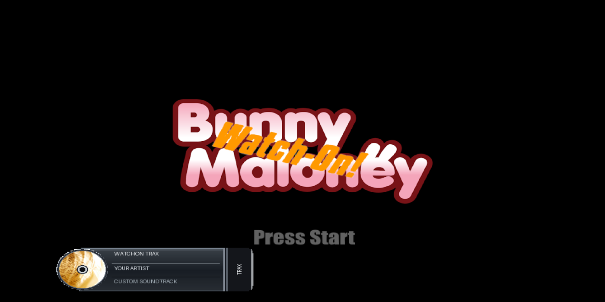
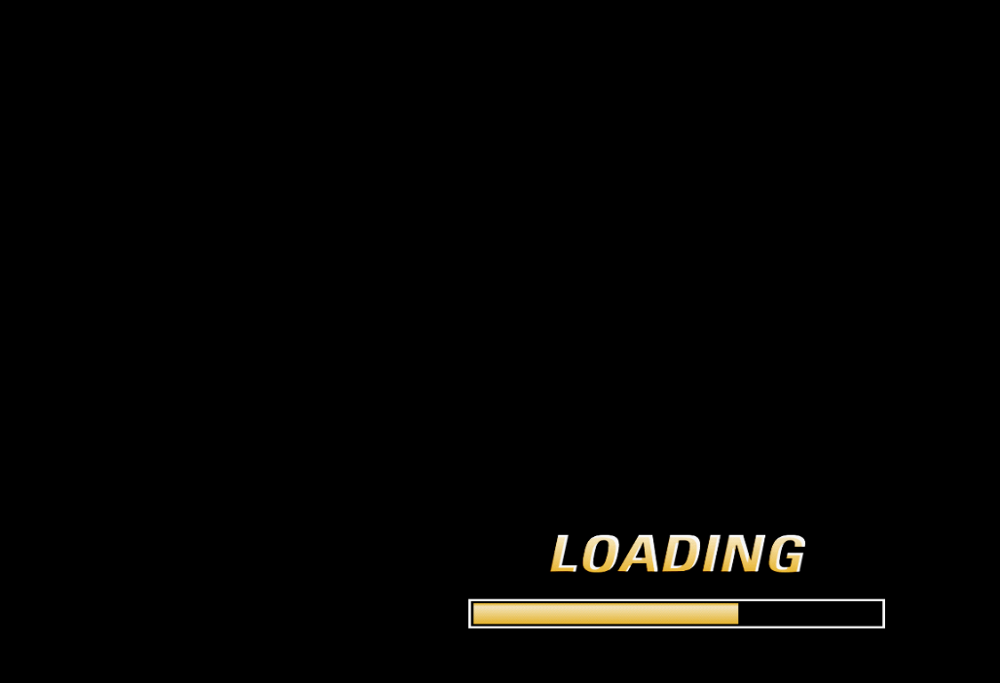

<div align="center">

# 📺 Bunny Maloney: WATCHON

**A fan-made PlayStation 2 homebrew media player, built around the world of *Bunny Maloney*.**

A retro-inspired way to browse episodes, play a full series in order, and enjoy a custom menu soundtrack through **WATCHON TRAX**.


**[Features](#-features) · [Controls](#-controls) · [Development setup](#-development-setup) · [Roadmap](#-roadmap)**



<sub>Development screenshot from PCSX2. Interface and media shown are illustrative; this is not a packaged public release.</sub>

</div>

---

## ✨ What is WATCHON?

**Bunny Maloney: WATCHON** is an experimental media player written in C for the **PlayStation 2**, developed and tested primarily through **PCSX2**.

It began as a simple way to present episodes in a console-style interface. The project has grown into a functional prototype with episode browsing, continuous playback, controller-driven menus, boot animations, and its own **WATCHON TRAX** soundtrack interface.

The focus is on a nostalgic PS2 experience: straightforward navigation, distinctive transitions, and a bit of personality.

> [!IMPORTANT]
> **Current status: working prototype (V4.5 checkpoint).** The developer's local build has passed its core functionality tests. The repository should **not** be assumed to contain a ready-to-run release, bundled episodes, or a complete standalone installer. Compatibility with physical PS2 hardware is not yet confirmed.

## 🎮 Features

| Feature | Current state |
| --- | --- |
| PS2-style boot presentation and loading screen | ✅ Working in the development build |
| Controller-driven title screen and menus | ✅ Working |
| Episode browser | ✅ Working |
| Individual episode playback | ✅ Working |
| **Play All** — continuous episode playback | ✅ Working |
| Return/cancel episode playback | ✅ Working |
| **WATCHON TRAX** — custom menu soundtrack | ✅ Working |
| Animated song notification with rotating artwork | ✅ Working |
| Music ON/OFF and Sequential/Random order | ✅ Working |
| Choose a song from the WATCHON TRAX menu | ✅ Working |
| **R3** shortcut to skip to another song | ✅ Working |
| Song changes without deliberate black-screen flashes | ✅ Working |
| One-click Windows music importer | 🛠️ Planned |
| Full settings persistence and standalone distribution | 🛠️ In progress / planned |

The local episode library is configured for **52 episodes**. Episode files, commercial music, and other third-party media are **not included** by this README.

## 🕹️ Controls

| Input | Action |
| --- | --- |
| **D-pad** | Navigate menus and selections |
| **✕ (Cross)** | Confirm / open selected item |
| **△ (Triangle)** | Go back; cancel episode playback |
| **START** | Continue from the title screen |
| **R3** (right-stick click) | Skip to the next WATCHON TRAX song while in a menu |
| **L3** (left-stick click) | Skip video when the **L3 Skip** option is enabled |

**WATCHON TRAX** is accessible from **Options**. Its menu lets you enable or disable music, switch between **Sequential** and **Random** playback, and select a track directly. The R3 shortcut follows the chosen playback order.

## 🎵 WATCHON TRAX

WATCHON TRAX gives the application its own soundtrack experience, including:

- An animated on-screen announcement when a track starts, with a rotating disc graphic and song-specific artwork.
- A browsable song list with a visible selection highlight and current-track indicator.
- **Sequential** playback or **Random** playback that avoids immediately repeating the same song when possible.
- Automatic music suspension while an episode plays and a new song on return to the menus.
- Settings stored in `Music/settings.cfg` when the development host filesystem is writable; otherwise, the settings remain active for the current session.

For the current development setup, songs are converted into PS2-friendly **16-bit, 22,050 Hz stereo PCM** with accompanying metadata and artwork files. The music importer is still a developer tool, not yet a finished public drag-and-drop application.

### Music folder layout (development build)

```text
Music/
├── Audio/                 # Imported .pcm tracks
├── Covers/                # Disc animation frames
├── Panels/                # WATCHON TRAX notification panels
├── UI/                    # Music-menu graphics and font atlas
├── library.json           # Importer library metadata
├── tracks.tsv             # Track list read by the PS2 app
└── settings.cfg           # Optional generated preferences
```

The application expects these files through the PS2 `host:` device in the currently tested environment. This is **not** yet a plug-and-play installation layout for retail PS2 consoles.

## 🛠️ Development setup

This project is still being prepared for public builds. The information below describes the **development workflow**, not a finished user installation guide.

**Development stack:**

- C, [PS2SDK](https://github.com/ps2dev/ps2sdk), and [gsKit](https://github.com/ps2dev/gsKit).
- `audsrv` for audio playback and PS2 controller input through `libpad`.
- Ubuntu / WSL for building, with **PCSX2** for testing.
- Local application textures, episode media, and generated soundtrack files.

```bash
# In a prepared PS2SDK development environment:
cd BunnyMaloneyWatchon
make
```

A working PS2SDK toolchain, the matching `Makefile`, and the required local assets are needed. The current player uses paths such as `host:Textures/...`, `host:Audio/...`, and `host:Music/...`; make sure the emulator host filesystem resolves these relative to the project directory.

> [!NOTE]
> No universal `main.elf` download, turn-key Windows importer, or hardware-ready package is promised here. Public setup instructions will be expanded when a reproducible distribution is available.

## 📸 More from development

<details>
<summary>View an earlier loading-screen screenshot</summary>

<br />



<sub>Earlier development capture; the interface may have changed since this screenshot.</sub>

</details>

## ⚠️ Known limitations

- **Brief music dropouts** can occur during some screen transitions because texture loading competes with the current menu audio-streaming loop. The music timeline catches up afterward, but the audible gap is not yet fully eliminated.
- Minor visual imperfections remain and are being tracked separately from functionality.
- The project has been primarily tested in **PCSX2**; real-console compatibility and other launch methods require further validation.
- Memory-card settings I/O is currently **disabled**. WATCHON TRAX preferences may persist through the writable host filesystem, but that is not the same as PS2 memory-card saving.
- User-friendly media importing, missing-file handling, and general release packaging need further work.

## 🗺️ Roadmap

- [x] Boot presentation and interactive menus
- [x] Episode playback, cancellation, and Play All
- [x] WATCHON TRAX player, track browser, artwork, and animated notifications
- [x] R3 song skipping and smoother song-to-song visual transitions
- [ ] Eliminate or significantly reduce audio dropouts during menu transitions
- [ ] Release a drag-and-drop Windows music importer
- [ ] Improve missing-file and empty-library handling
- [ ] Revisit persistent settings and memory-card support
- [ ] Test a clean installation and physical PS2 compatibility
- [ ] Polish interface details and document a reproducible public release

## 🤝 Feedback

This is an independent hobby project in active development. Bug reports, reproducible test results, and thoughtful suggestions are welcome.

When reporting a problem, please include the **build version**, whether you tested on **PCSX2 or physical hardware**, what you were doing, and any relevant log output. Avoid attaching copyrighted episode or music files to bug reports.

## ⚖️ Disclaimer and media rights

**Bunny Maloney: WATCHON is an unofficial fan-made project.** It is not affiliated with, endorsed by, or sponsored by the creators or rights holders of *Bunny Maloney*, Sony, or any other referenced franchise or service.

*Bunny Maloney* characters, branding, episodes, and related material remain the property of their respective rights holders. Commercial music belongs to its respective rights holders. Users and contributors are responsible for obtaining and using media they have permission to use. No permission to redistribute third-party material is implied by this repository or documentation.

---

<div align="center">

**Made for the fun of building something new for the PlayStation 2.** 🐰🎮

*Bunny Maloney: WATCHON — a work in progress, one feature at a time.*

</div>
